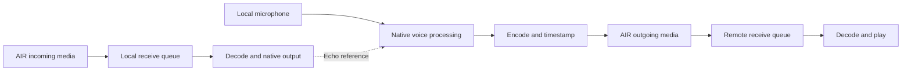

# iOS and Android calling with AIR

Design proposal, 22 October 2026. Scope: one-to-one, two-way app calls that play remote audio
received through AIR and send local microphone audio back through AIR.

Use native calling APIs for ringing, answering, ending, and audio ownership. Keep call signaling
and media exchange in AIR/RAMP. A native call interface does not carry audio between devices;
Maverick must supply the microphone and playback pipeline. This proposal does not implement a
calling API or establish the latency of AIR on real phones.

## Platform behavior and triggers

| Operation | iOS | Android |
| --- | --- | --- |
| Receive while the app is running | Handle an AIR invitation and call `CXProvider.reportNewIncomingCall(with:update:completion:)`. | Handle an AIR invitation and call `CallsManager.addCall` with incoming attributes, then present a call notification. |
| Receive while suspended or after an OS process termination | A PushKit VoIP push launches/wakes the app; its delegate reports the call to CallKit promptly. | Use a push receiver able to start call handling without an Activity; for Google Play devices, use FCM. |
| Place an outgoing app call | Request a `CXStartCallAction` through `CXCallController`; begin signaling when the provider receives the accepted action. | Add an outgoing call; report it active when the remote participant accepts. |
| Answer, reject, end, mute, hold | Handle the corresponding provider actions and audio activation/deactivation callbacks. | Handle Telecom callbacks and notification actions, including actions from headsets and other remote surfaces. |

iOS uses the system calling interface. The provider reports connection progress and failure.
Configure audio before fulfilling start/answer actions, but start audio only when the system
activates the call's audio session. Use an app identity as the handle rather than inventing a
telephone number. [Apple calling lifecycle](https://developer.apple.com/documentation/callkit/making-and-receiving-voip-calls)

On Android, prefer Core-Telecom for system integration. Register with `CallsManager`, declare
`MANAGE_OWN_CALLS`, and host calls independently of the Activity. `addCall` initially means
ringing/dialing, not connected. Observe its endpoint and mute flows; request routes through
Telecom rather than separately invoking Bluetooth SCO or `setCommunicationDevice`. Callback
actions must finish within five seconds, and the call notification must be posted within five
seconds of adding the call. [Android Core-Telecom](https://developer.android.com/develop/connectivity/telecom/voip-app/telecom)

Android supplies a `CallStyle` notification with answer/decline or hang-up actions; the app owns
its call Activity. A full-screen incoming Activity requires the applicable full-screen intent
permission and is subject to system/user settings. It is not guaranteed to appear as the stock
Phone app. Keep notification actions functional when the Activity is absent.
[Call notifications](https://developer.android.com/develop/ui/compose/notifications/call-style),
[full-screen intent behavior](https://developer.android.com/about/versions/14/behavior-changes-14#secure-fsi-notifications)

The proposed feature is app-to-app VoIP. Dialing a carrier number is a different integration;
these call APIs do not turn AIR segments into carrier-call media.

## Existing implementation and gaps

These findings describe the working tree inspected on the date above; Android push work was
changing during inspection.

| Area | Existing implementation | Work needed for calls |
| --- | --- | --- |
| Audio content | `Media::read`, `TryFrom<Sound>`, track-selective `copy`/`replace`, `append`, and shared timelines. | A bounded live receive queue with timestamps and deadlines. |
| Playback | `Player` uses CPAL output for audio and follows growing timelines with `set_mode(PlaybackMode::Live(delay))`. | Call audio ownership, route handling, and a duplex voice-processing path. |
| iOS microphone | `AVCaptureAudioDataOutput` feeds the capture timeline. | Voice processing with echo cancellation and call-specific session activation. |
| Android microphone | `CaptureHub::microphone` returns an unsupported error. | Native microphone capture, permission handling, and voice processing. |
| iOS audio session | `AudioSession::acquire` selects playback/play-and-record and calls `setActive(true)`; dropping it can deactivate the session. | Coordinate ordinary media and call ownership; CallKit activation must govern call audio. |
| Android audio session | `AudioSession::new` is a no-op. | Telecom integration and communication audio configuration. |
| Push | Ordinary APNs alerts; FCM destination/configuration/server work is appearing. Android `Push::current` still waits indefinitely at inspection. | Separate VoIP token registration on iOS; Android native receiver; call-specific payloads and delivery. |
| Startup | Runtime/hardware/application creation follows window creation in `resumed`. Android helpers obtain `MaverickActivity.current()`. | Initialize call handling from native application/service startup without a window. |

Relevant source locations:

- [Audio content](/Users/caleb/maverick_os/src/hardware/media.rs)
- [iOS audio session](/Users/caleb/maverick_os/src/hardware/ios.rs:102)
- [Apple microphone capture](/Users/caleb/maverick_os/src/hardware/apple/capture.rs:178)
- [Android capture and session stubs](/Users/caleb/maverick_os/src/hardware/android.rs:261)
- [Speaker output](/Users/caleb/maverick_os/src/hardware/media/speaker.rs)
- [Application startup](/Users/caleb/maverick_os/src/lib.rs:212)
- [RAMP AIR integration](/Users/caleb/ramp/src/air.rs:28)
- [Notification contracts](/Users/caleb/air_notifications/src/lib.rs)

## Incoming call delivery

### iOS

Create one `CXProvider` and a retained `PKPushRegistry` early in native startup. Register `.voIP`
and send the resulting token to the notification service. This is a separate destination from
ordinary APNs registration; handle its rotation and invalidation explicitly.
[PushKit registration](https://developer.apple.com/documentation/pushkit/supporting-pushkit-notifications-in-your-app)

The server sends an invitation containing a stable call UUID and enough information to identify
the call without fetching audio first. Use the VoIP token, `apns-push-type: voip`,
`apns-topic: <bundle-id>.voip`, immediate priority, and zero or very short expiry. Push acceptance
does not establish that the device rang.
[APNs requests](https://developer.apple.com/documentation/usernotifications/sending-notification-requests-to-apns)

Report the incoming call promptly in the PushKit callback and reconnect to AIR in parallel.
Do not wait for AIR replay, profile fetching, audio decoding, or a render tick before reporting.
Complete PushKit handling after the report callback. If answering precedes connection readiness,
keep the answer action pending within its deadline; fulfill it once ready or fail it. Send later
cancellation/status through the established connection, rather than additional VoIP pushes.
CallKit respects system call policies such as Do Not Disturb.
[Handling VoIP pushes](https://developer.apple.com/documentation/pushkit/responding-to-voip-notifications-from-pushkit)

Piston must package the linked frameworks, push entitlement, relevant VoIP/background audio
configuration, and an accurate microphone usage description. Permission must be available
before a locked-screen answer needs microphone access.

### Android

For the initial FCM implementation, use the documented HTTP v1 high-priority data-message path
with a short call lifetime. `FirebaseMessagingService.onMessageReceived` handles data messages
in the background; a notification-only payload normally goes to the tray instead of this
callback. Start prompt call presentation and transfer ongoing work to the call service.
Do not download media inside the short receiver callback. High-priority delivery is best effort
and intended for visible, time-sensitive events.
[Receiving FCM messages](https://firebase.google.com/docs/cloud-messaging/android/receive-messages),
[FCM priority](https://firebase.google.com/docs/cloud-messaging/android-message-priority)

Declare `FOREGROUND_SERVICE`, `FOREGROUND_SERVICE_PHONE_CALL`, the `phoneCall` service type,
and `MANAGE_OWN_CALLS`. Obtain `RECORD_AUDIO` for capture. If microphone foreground-service
work is separately declared, include its permission/type and satisfy its while-in-use rules;
an incoming push is not blanket permission to start recording. Start capture after answer and
successful call/audio setup. [Foreground service requirements](https://developer.android.com/develop/background-work/services/fgs/service-types)

Handle notification permission according to the selected Telecom integration. Android documents
an exemption for properly configured self-managed `CallStyle` calls; declaring
`MANAGE_OWN_CALLS` alone is insufficient. Ordinary chat notifications retain their own permission
requirements. [Notification permission](https://developer.android.com/develop/ui/compose/notifications/notification-permission#apps-configured-to-self-manage-phone-calls)

The current APK builder invokes `javac`, `d8`, and `aapt2` directly. Core-Telecom's Kotlin,
coroutines, AndroidX dependencies, and manifest integration need deliberate packaging support.
A native service must hold application context and initialize the Rust call runtime without
depending on `MaverickActivity.current()`.
[Current Android builder](/Users/caleb/maverick_os/android/build.py:45)

## Proposed division of responsibilities

Follow [the canonical style guide](/Users/caleb/ramp/STYLE_GUIDE.md): typed capabilities,
context-owned shared services, private native delegates, matching platform interfaces, and
protocol contracts independent of UI/hardware crates.

- **Maverick:** native call presentation/actions, permission handling, audio activation, device
  routes, microphone/output lifetime, and platform voice processing. Native call support must
  initialize at launch even though ordinary hardware remains lazy.
- **AIR contracts:** invitation, acceptance, decline, cancellation, end reason, participant
  identity, expiry, media format, and references to each direction's media stream.
- **RAMP:** one call service per application identity coordinating the AIR session and Maverick
  capability. Reuse the existing network client/services. Keep it alive independently of the
  displayed page and publish state/events to Prism.
- **Application:** who to call, whom to accept, and the in-app controls. Native actions enter
  the same service as these controls; UI delivery is not a prerequisite for handling an answer.
- **Notification server:** authorized call wakeups with expiry and duplicate handling. Keep
  provider credentials scoped to the owning app and out of device builds.

The current `Watch` observes an opaque next-file key and sends a generic alert after 500 ms.
It cannot infer whether that encrypted file represents a call or obtain its call UUID. Introduce
an explicit call-delivery contract/purpose with sufficient metadata, or a dedicated invitation
channel whose meaning and envelope are established in advance. Do not convert every watched
chat update into a VoIP push. Reuse provider infrastructure while giving calls their own
acknowledgment, expiry, and retry behavior.

Use a call UUID shared by signaling and the native call mapping. Validate the participant and
session before admitting media. A trusted wake envelope should permit prompt call reporting;
full AIR synchronization then confirms current state. Deduplicate direct delivery and push
delivery, retain ended-call identifiers briefly, and reject expired invitations. On iOS, the
adapter must still satisfy its PushKit reporting obligations when a stale push arrives; never
silently return from the callback merely because an AIR lookup is pending.

Track call state separately from audio readiness: ringing, connecting, active, held, and ended
do not imply that a native audio device is currently active. Stop microphone transmission
immediately on mute/hold/end; discard queued capture so unmuting cannot transmit old speech.
Hang-up releases local audio immediately, even if the AIR end message is awaiting delivery.
An active call should have a bounded connection-failure timeout independent of audio silence.

For multiple installations, acceptance needs one confirmed winning installation per call.
Other installations then end their ringing call. Native callback deadlines must not wait
indefinitely for this arbitration.

## Two-way audio through AIR

Give each direction its own single-writer media stream. Keep control traffic separate so
queued audio cannot delay hang-up or acceptance. Each media segment needs the call ID, stream
epoch, sequence number, sample timestamp/count, and encoded payload. Negotiate codec/rate/channel
count at session setup. Use sample timestamps relative to that stream; remote wall clocks
must not determine playout timing.

For a first codec candidate, evaluate mono Opus with 20 ms frames. Opus is designed for
interactive speech and supports packet-loss concealment. Keep encoder/decoder state across
frames, and verify actual encode/decode availability in the bundled build before choosing the
dependency. [Opus specification](https://www.rfc-editor.org/rfc/rfc6716)

The receiver should maintain a bounded jitter buffer, drop duplicates and obsolete segments,
conceal missing frames, and adjust for clock drift. Network/decryption/codec work must stay
off the real-time audio callback. Prototype a 60–120 ms playout buffer and measure the result;
these are tuning starting points, not measured AIR performance. On reconnect, resume the live
epoch rather than playing the accumulated outage.

On iOS, use Voice Processing I/O or `AVAudioEngine` with voice processing enabled, with a
play-and-record/voice-chat audio session. Setting `.voiceChat` alone does not provide echo
cancellation for arbitrary capture/output pipelines. Remote playback must pass through the
voice-processing output path so it supplies the echo reference.
[Apple voice processing](https://developer.apple.com/documentation/avfaudio/avaudiosession/mode-swift.struct/voicechat)

On Android, implement communication microphone capture such as `AudioRecord` with
`VOICE_COMMUNICATION`, and communication playback under Telecom routing. Inspect the device's
echo-cancellation support rather than assuming it exists. If using `AcousticEchoCanceler`,
associate it with the recorder's audio session and avoid applying duplicate processing.
[Communication capture](https://developer.android.com/reference/android/media/MediaRecorder.AudioSource#VOICE_COMMUNICATION),
[echo cancellation](https://developer.android.com/reference/android/media/audiofx/AcousticEchoCanceler)

### Reusing the existing audio API

An initial foreground experiment can decode each received file segment, append it with
`audio.append(&segment)` without `?`, and retain one `Player` reading that shared timeline.
Copy only newly captured microphone ranges for transmission. Avoid creating one player
per segment or repeatedly encoding the entire accumulated microphone recording.

This is a delivery experiment, not the finished duplex pipeline. `Media::write(writer, Format::Wav_PcmF32le)` exports audio through a WAV container
using float PCM. At 48 kHz mono, 32-bit PCM alone is
1.536 Mbit/s per direction before container, encryption, and protocol overhead. The timeline
retains history, and `PlaybackMode::Live` may seek forward when more than 100 ms behind its target;
that is different from a voice jitter buffer's handling of missing frames. Calls need bounded
live storage and explicit recording only when the application requests it.
[Archive codec](/Users/caleb/maverick_os/src/hardware/media/archive.rs),
[audio export](/Users/caleb/maverick_os/src/hardware/media.rs),
[live playback](/Users/caleb/maverick_os/src/hardware/media/playback.rs)

### AIR latency is the first measurement gate

`Channel::request` holds one outstanding create per channel. On its normal successful path,
the next queued create waits for the preceding response. RAMP currently selects WSS transport.
Therefore small sequential writes can fall behind real-time capture even when bandwidth is
ample. This is an inference from the current code, not a network benchmark.
[AIR request sequencing](/Users/caleb/air/src/channel.rs:100),
[RAMP transport](/Users/caleb/ramp/src/air.rs)

For example, 20 ms segments arrive at 50 writes/second. If a write response takes 80 ms,
one channel can complete roughly 12.5 writes/second: only 250 ms of captured audio per second.
Batching four frames per write removes that idealized throughput deficit but adds collection
delay and leaves no margin for jitter. Reliable transport can also hold newer media behind
late bytes, and reconnection/replay adds another source of delay.

Measure capture-to-playout latency, write acknowledgment latency, queue age, CPU, and memory
before relying on durable per-segment writes for phone-like conversation. If those measurements
fail, retain AIR identity/signaling and design an AIR media transport with bounded in-flight
work and expiry semantics. Merely dropping stale audio after fetching an entire backlog does
not fix the transport bottleneck. Do not replace AIR or add a parallel networking stack
without making that architectural choice explicitly.

## Implementation order and acceptance checks

1. **Measure foreground media.** Exchange timestamped audio in both directions using two
   independent media streams. Compare segment/batch sizes on Wi-Fi and cellular. Verify that
   queues do not grow during a sustained call. Establish the media format and latency budget.
2. **Implement native duplex audio and local call controls.** Add iOS call ownership and voice
   processing, Android communication capture/output, and one shared call state machine. Use
   local debug invitations to exercise incoming UI before introducing remote wakeup.
3. **Add background startup and call signaling.** Support native answer/end without an open
   page or Activity, reconcile AIR and system state, and handle decline, timeout, and busy.
4. **Add remote ringing.** Register VoIP/FCM destinations, implement authorized call envelopes,
   update packaging, and test signed builds on actual phones.

Verify incoming and outgoing calls while foregrounded, backgrounded, and locked; test an OS
terminated process separately from explicit user force-quit/force-stop. Exercise microphone
denial, notification/full-screen restrictions, Focus/Do Not Disturb, answer before network
readiness, duplicate/expired invites, caller cancellation during ringing, and two installations
answering at once. Device policy and push delivery prevent an unconditional promise that every
incoming call rings.

Test receiver, speakerphone, wired and Bluetooth routes; route removal; cellular-call
interruption; mute/unmute; hold/resume; loss/reorder/stalls; and Wi-Fi/cellular handover. Confirm
that remote audio is not echoed back, stale capture never leaks after unmute, and hang-up stops
capture/output even without a network. A long call must not grow retained audio or queued
writes without bound. Record real capture-to-playout measurements before calling the media
path ready for conversational use.
